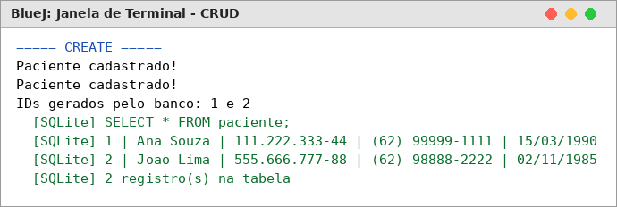
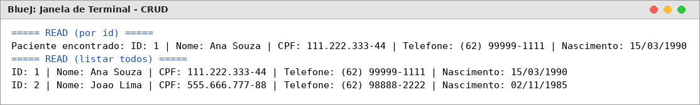
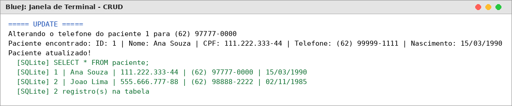
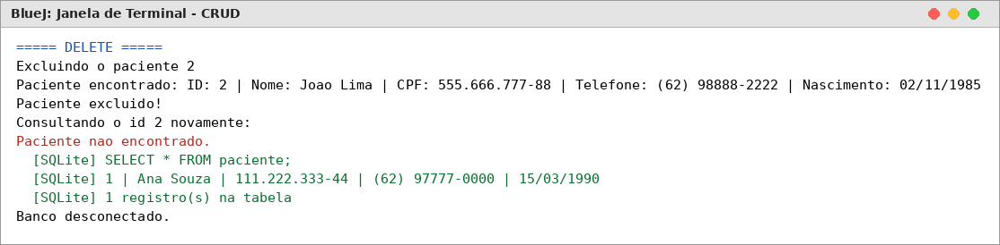
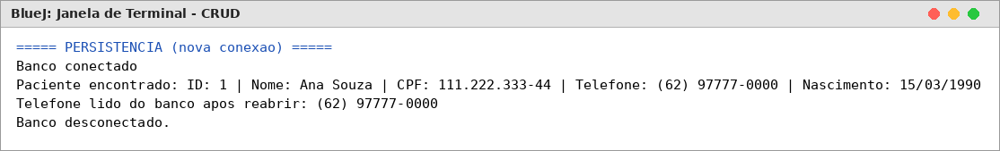
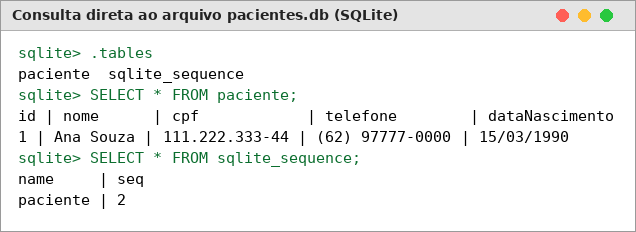
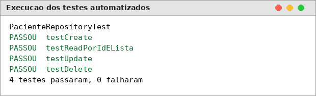

# Atividade Prática – Persistência de Dados com ORM e CRUD

**Aluno:** Carlos
**Disciplina:** Programação Orientada a Objetos
**Tecnologias:** Java · BlueJ · ORMLite 6.1 · SQLite (sqlite-jdbc 3.46.0.0) · SLF4J 2.0.13

Implementação das operações **CRUD** (Create, Read, Update e Delete) para a entidade `Paciente`, usando o ORM **ORMLite** para persistir os objetos em um banco **SQLite**, seguindo o padrão **Repository** do [tutorial de ORM com Java, ORMLite e SQLite](https://github.com/marceloakira/tutorials/blob/main/orm/README.md).

---

## 1. Classe escolhida: `Paciente`

A classe `Paciente` representa um paciente de um sistema de clínica. É um POJO (atributos privados + getters e setters) mapeado para a tabela `paciente` por meio das anotações do ORMLite:

```java
@DatabaseTable(tableName = "paciente")
public class Paciente {

    @DatabaseField(generatedId = true)   // chave primária auto-incrementada pelo banco
    private int id;

    @DatabaseField(canBeNull = false)    // NOT NULL
    private String nome;

    @DatabaseField
    private String cpf;

    @DatabaseField
    private String telefone;

    @DatabaseField
    private String dataNascimento;
    ...
}
```

| Atributo Java    | Coluna no banco  | Tipo SQLite                       |
|------------------|------------------|-----------------------------------|
| `id`             | `id`             | INTEGER PRIMARY KEY AUTOINCREMENT |
| `nome`           | `nome`           | VARCHAR NOT NULL                  |
| `cpf`            | `cpf`            | VARCHAR                           |
| `telefone`       | `telefone`       | VARCHAR                           |
| `dataNascimento` | `dataNascimento` | VARCHAR                           |

A classe também tem um construtor vazio (exigido pelo ORMLite para recriar os objetos ao ler do banco) e um `toString()` para facilitar a visualização nos testes.

## 2. Estrutura do projeto

| Classe | Papel |
|---|---|
| `Database` | Abre e fecha a conexão (`JdbcConnectionSource`) com o arquivo SQLite `jdbc:sqlite:<arquivo>`. |
| `Paciente` | Entidade mapeada para a tabela `paciente`. |
| `PacienteRepository` | Padrão **Repository**: usa um `Dao<Paciente, Integer>` do ORMLite para fazer o CRUD e cria a tabela com `TableUtils.createTableIfNotExists`. Mantém em memória o último paciente carregado e a lista de pacientes carregados. |
| `TesteCRUD` | Demonstração das quatro operações. Pode ser executada pelo `main` ou chamando cada método no BlueJ. O método `mostrarTabela()` lê o arquivo `.db` com **SQL puro (JDBC)**, sem o ORM, para comprovar o que está gravado de fato. |
| `PacienteRepositoryTest` | Testes automatizados (JUnit 4, suportado pelo BlueJ), um para cada operação, usando um banco separado (`pacientes_teste.db`). |

### Operações do `PacienteRepository`

| Operação | Método | Chamada ao ORMLite |
|---|---|---|
| **Create** | `create(Paciente p)` | `dao.create(p)` – insere e preenche o `id` gerado |
| **Read** | `loadFromId(int id)` | `dao.queryForId(id)` |
| **Read** | `loadAll()` | `dao.queryForAll()` |
| **Update** | `update(Paciente p)` | `dao.update(p)` – atualiza a linha pelo `id` |
| **Delete** | `delete(Paciente p)` | `dao.delete(p)` – remove a linha pelo `id` |

Nenhuma instrução SQL foi escrita à mão no repositório: o ORMLite gera os `CREATE TABLE`, `INSERT`, `SELECT`, `UPDATE` e `DELETE` a partir das anotações.

## 3. Como executar

1. As bibliotecas estão na pasta `+libs/` do projeto (o BlueJ carrega automaticamente os `.jar` dessa pasta). Se preferir, também podem ser adicionadas em *Ferramentas → Preferências → Bibliotecas*, como no tutorial.
2. Abrir o projeto no BlueJ e clicar em **Compilar**.
3. Clicar com o botão direito em `TesteCRUD` → `void main(String[] args)` para rodar a demonstração completa, **ou** criar um objeto `TesteCRUD` e chamar os métodos `cadastrar`, `consultarPorId`, `listarTodos`, `atualizarTelefone`, `excluir` e `mostrarTabela` um a um.
4. Clicar com o botão direito em `PacienteRepositoryTest` → **Testar Tudo** para rodar os testes automatizados.
5. O banco é gravado no arquivo `pacientes.db`, que pode ser aberto no [DB Browser for SQLite](https://sqlitebrowser.org/).

---

## 4. Evidências de funcionamento

O roteiro do `TesteCRUD` cadastra dois pacientes, consulta, altera o telefone de um, exclui o outro e, por fim, **fecha a conexão e abre uma nova** para mostrar que os dados continuam no arquivo. As linhas em verde marcadas com `[SQLite]` vêm de um `SELECT` feito diretamente no banco, sem passar pelo ORM.

### 4.1 Create – cadastro de pacientes



Dois objetos `Paciente` foram criados em memória (objetos transientes) e passados ao `repositorio.create(...)`. O ORMLite executou o `INSERT` e o SQLite gerou os ids **1** e **2**, que foram preenchidos automaticamente nos objetos. O `SELECT` direto na tabela confirma os **2 registros gravados**.

### 4.2 Read – consulta por id e listagem



- `loadFromId(1)` buscou no banco a paciente **Ana Souza** pelo identificador.
- `loadAll()` retornou a lista com **todos** os pacientes cadastrados (ids 1 e 2), com todos os campos preenchidos a partir do banco.

### 4.3 Update – atualização de dados



O paciente de id 1 foi carregado, o telefone foi alterado no objeto com `setTelefone(...)` e o objeto foi enviado para `repositorio.update(...)`. O `SELECT` direto no banco mostra que o telefone passou de **(62) 99999-1111** para **(62) 97777-0000**, e que o outro registro não foi alterado.

### 4.4 Delete – exclusão



O paciente de id 2 (**Joao Lima**) foi excluído com `repositorio.delete(...)`. Logo depois, `loadFromId(2)` retorna **"Paciente nao encontrado"** e o `SELECT` direto mostra que **sobrou apenas 1 registro** na tabela.

### 4.5 Persistência – dados continuam após reabrir a conexão



A conexão foi fechada (`database.close()`) e um **novo** `Database`/`PacienteRepository` foi criado. Ao consultar o id 1, o telefone veio **já atualizado**, ou seja, o valor foi lido do arquivo `pacientes.db` e não da memória.

### 4.6 Conteúdo final do arquivo `pacientes.db`



Consulta feita direto no arquivo `pacientes.db` do repositório, depois do programa terminar:

- O ORMLite criou a tabela `paciente` e a tabela interna `sqlite_sequence` (controle do auto-incremento).
- A tabela `paciente` contém só a **Ana Souza com o telefone novo** → os dados foram **armazenados** (Create) e **atualizados** (Update).
- `sqlite_sequence` registra **seq = 2**: dois pacientes chegaram a ser inseridos, mas o id 2 não está mais na tabela → o registro foi **excluído** (Delete).

### 4.7 Testes automatizados



A classe `PacienteRepositoryTest` testa cada operação isoladamente, com um banco limpo a cada teste:

| Teste | O que verifica |
|---|---|
| `testCreate` | o objeto é salvo, recebe um `id` > 0 e passa a aparecer na listagem |
| `testReadPorIdELista` | `loadFromId` devolve o paciente certo e `loadAll` devolve os 2 cadastrados |
| `testUpdate` | após `update`, fechar e reabrir a conexão, o telefone lido do banco é o novo |
| `testDelete` | após `delete`, `loadFromId` devolve `null` e a tabela fica vazia |

Os **4 testes passaram**.

---

## 5. Conclusão

Com o ORMLite foi possível persistir objetos `Paciente` em um banco SQLite sem escrever SQL, apenas anotando a classe de modelo e usando um `Dao` dentro de um repositório. O padrão Repository deixou as operações de banco concentradas em `PacienteRepository`, separadas da classe de modelo e dos testes. As evidências mostram que os dados foram efetivamente gravados, consultados, atualizados e excluídos do arquivo `pacientes.db`.
