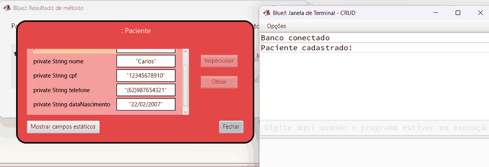
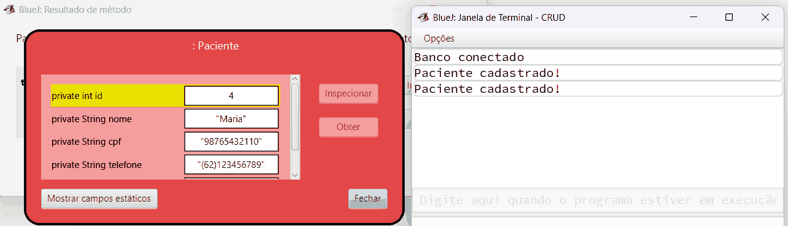
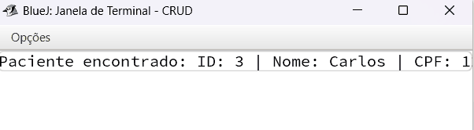
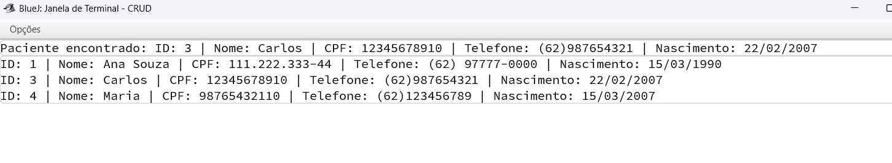
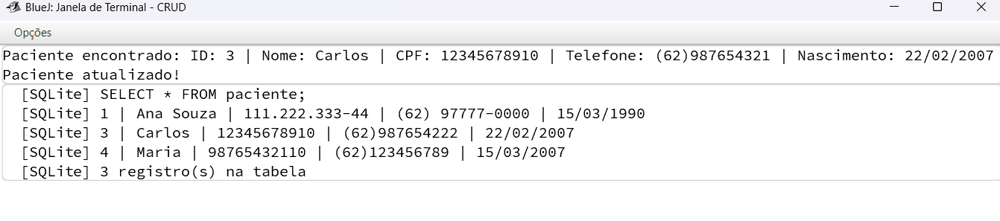
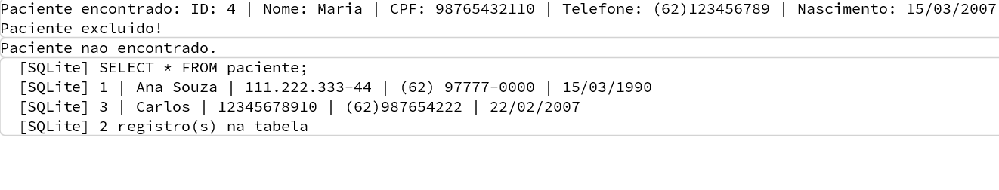
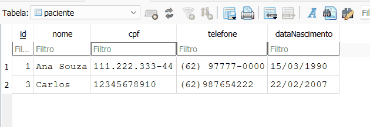

# Atividade Prática – Persistência de Dados com ORM e CRUD

**Aluno:** Carlos  
**Disciplina:** Programação Orientada a Objetos  
**Tecnologias:** Java, BlueJ, ORMLite e SQLite

## 1. Classe escolhida: `Paciente`

A classe `Paciente` representa os pacientes de uma clínica. Ela possui os atributos id, nome, CPF, telefone e data de nascimento.

O ORMLite é utilizado para conectar os objetos Java ao banco de dados SQLite, permitindo salvar e consultar as informações dos pacientes.

## 2. Estrutura do projeto

O projeto possui as seguintes classes:

- `Database`: realiza a conexão com o banco de dados.
- `Paciente`: armazena os dados dos pacientes.
- `PacienteRepository`: realiza as operações no banco de dados.
- `TesteCRUD`: executa as operações para demonstrar o funcionamento.
- `PacienteRepositoryTest`: realiza os testes automatizados.

## 3. Operações CRUD

Foram implementadas as quatro operações do CRUD:

- **Create:** cadastra um paciente no banco de dados.
- **Read:** consulta um paciente pelo ID ou lista todos os cadastrados.
- **Update:** atualiza os dados de um paciente.
- **Delete:** exclui um paciente do banco de dados.

O ORMLite facilita essas operações, sem a necessidade de escrever os comandos SQL manualmente.

## 4. Testes realizados

As operações foram executadas de forma interativa no BlueJ, criando um objeto `TesteCRUD` e chamando seus métodos. O banco já tinha a paciente Ana Souza (id 1), cadastrada em um teste anterior.

### 4.1 Create – cadastro de pacientes

Foi chamado o método `cadastrar` com os dados do paciente **Carlos**. O terminal mostra "Paciente cadastrado!" e a janela de resultado mostra o objeto `Paciente` salvo.

Em seguida foi cadastrada a paciente **Maria**. Ao inspecionar o objeto, é possível ver que o banco gerou automaticamente o **id 4** para ela.

### 4.2 Read – consulta por id e listagem

Com o método `consultarPorId(3)`, o paciente Carlos foi buscado no banco pelo seu identificador.

Com o método `listarTodos()`, foram listados todos os pacientes cadastrados no banco (ids 1, 3 e 4).

### 4.3 Update – atualização de dados

O telefone do paciente Carlos (id 3) foi alterado de **(62)987654321** para **(62)987654222** com o método `atualizarTelefone`. A consulta direta à tabela (`mostrarTabela()`, linhas `[SQLite]`) confirma que o novo telefone foi gravado no banco.

### 4.4 Delete – exclusão

A paciente Maria (id 4) foi excluída com o método `excluir`. Ao consultar o id 4 novamente, aparece "Paciente nao encontrado", e a tabela passa a ter apenas 2 registros.

### 4.5 Dados armazenados no banco

Por fim, o arquivo `pacientes.db` foi aberto no **DB Browser for SQLite**. A tabela `paciente` mostra os dados realmente gravados: o paciente Carlos com o telefone atualizado e sem a paciente Maria, que foi excluída. Isso comprova que os dados foram armazenados, consultados, atualizados e excluídos do banco de dados.

### 4.6 Testes automatizados

Também foi criada a classe `PacienteRepositoryTest`, com testes automatizados (JUnit) para as quatro operações. Os quatro testes passaram com sucesso.
